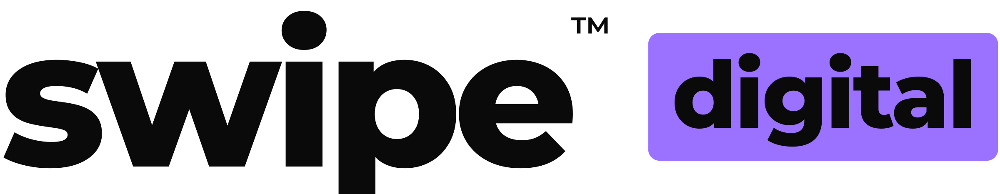

  

# swipe digital — Kit de marca

swipe digital es el brazo de swipe™ que gestiona el tráfico pago de las empresas y construye la tecnología que convierte ese tráfico en ventas.

> **Traemos los clientes. Y construimos el sistema que los convierte.**

Hernandarias · Una empresa del grupo swipe™

---

## Contenido

| Carpeta | Qué hay |
|---|---|
| [`manual/`](manual) | Manual de marca completo en PDF (14 páginas) y su fuente en HTML |
| [`logos/`](logos) | Logotipo en SVG (vector) y PNG (2400 px, fondo transparente) |
| [`icono/`](icono) | Ícono en SVG, PNG de 32 a 1024 px y `favicon.ico` |
| [`colores/`](colores) | Paleta en `colores.json` y variables CSS en `tokens.css` |

## Logotipo

"swipe™" es el logotipo original de la agencia y **no se modifica**. Lo que identifica a la nueva marca es "digital" dentro de un bloque violeta.

| Archivo | Cuándo usarlo |
|---|---|
| `swipe-digital-logo-principal` | Sobre fondos oscuros. Es la versión por defecto. |
| `swipe-digital-logo-sobre-claro` | Sobre blanco o hueso |
| `swipe-digital-logo-mono-blanco` | Un solo color sobre oscuro |
| `swipe-digital-logo-mono-negro` | Un solo color sobre claro, sellos e impresión a 1 tinta |

- **Área de protección:** dejar libre alrededor del logo, como mínimo, la altura del bloque "digital".
- **Tamaño mínimo:** 120 px de ancho en pantalla y 30 mm impreso. Por debajo de eso se usa el ícono.
- **No se hace:** cambiar la tipografía de swipe, cambiar el color del bloque, usar "digital" sin el bloque, deformar el logo, separar las partes o ponerlo sobre fondos sin contraste.

## Ícono

La misma S de swipe™ sobre fondo ciruela con borde violeta. Se usa en perfiles de redes, WhatsApp Business, favicon y donde el logo completo no entra.

## Color

| Color | HEX | Uso |
|---|---|---|
| Negro | `#0A0A0B` | Fondo principal (60%) |
| Blanco | `#FFFFFF` | Logo y textos |
| Violeta digital | `#9B72FF` | Bloque del logo y acentos, poco por pieza |
| Ciruela | `#22102C` | Ícono y bloques destacados |
| Hueso | `#F3F1EC` | Propuestas e impresos |

## Tipografía

Las tres son gratuitas en Google Fonts.

- **Montserrat ExtraBold** (la de swipe™) para titulares
- **Inter** para textos
- **JetBrains Mono** para datos, métricas y etiquetas

## Servicios

1. **Gestión de tráfico pago** (servicio principal): Meta Ads, Google Ads y TikTok Ads
2. **Web y e-commerce**: páginas web, landings y tiendas online
3. **Agentes de IA**: atención y calificación de leads 24/7
4. **CRM y automatización**
5. **Software a medida**

## Voz

Hablamos de ventas, no de herramientas: decimos "costo por venta" y no "likes y alcance", "diagnóstico" y no "cotización gratis". Frases cortas, sin emojis y con voseo.

---

**Nota:** la S y el "swipe™" se recrearon con Montserrat a partir del Instagram de la agencia. Si existe el archivo original del logo de swipe™, conviene reemplazarlos por ese.
